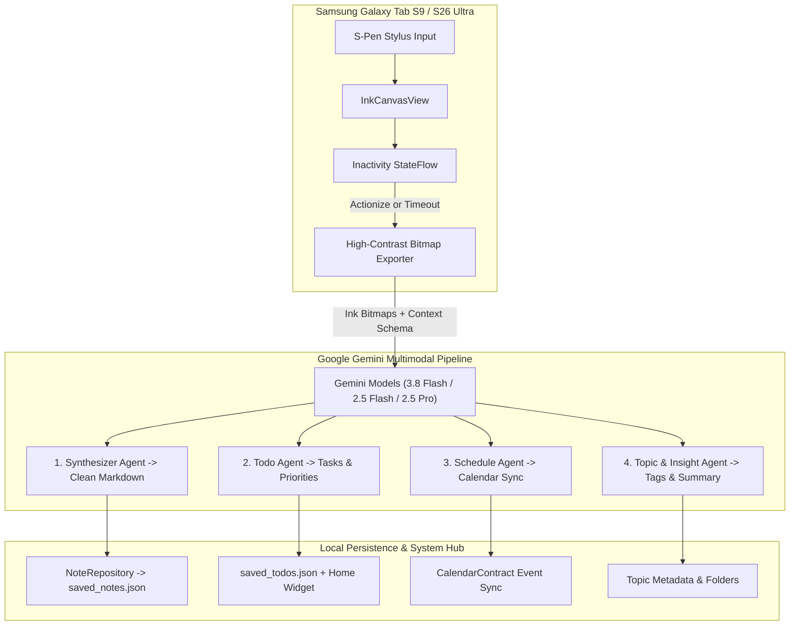

<div align="center">

# 📱 InkAction (Android S-Pen AI)
### *Next-Gen AI Workspace for Samsung Galaxy Tab S9 & Galaxy S26 Ultra*

[](https://github.com/ForcePushDavid/InkAction)
[](https://kotlinlang.org)
[](https://developer.android.com/jetpack/compose)
[](#)
[](#)
[](https://ai.google.dev/)
[](https://github.com/ForcePushDavid/InkAction/releases)

*Write thoughts freely with your Samsung S-Pen. InkAction senses when you pause and uses Google Gemini multimodal agents to synthesize clean Markdown notes, actionable Todo task checklists, and automatic calendar appointments.*

---

</div>

## 🌟 Key Features

- **Zero Note Re-reading**: Never struggle to decipher messy handwriting or forgotten sketches again.
- **Hardware S-Pen & Stylus Optimization**:
  - Pressure-sensitive stylus engine (`MotionEvent.TOOL_TYPE_STYLUS`).
  - True **Hardware Palm Rejection** (ignores accidental finger touches when the stylus is in proximity).
  - S-Pen hardware barrel button support for instant eraser switching.
  - **Smart Stroke Eraser**: Remove entire lines/strokes with a single touch, just like in Samsung Notes.
- **"Done Writing" Auto-Push Engine**:
  - Automatically dispatches high-contrast bitmap snapshots to Google Gemini once you stop writing.
  - Non-intrusive status pill in the top bar with countdown and progress states.
- **Indigo Ink Material 3 Design**:
  - Purpose-built palette featuring Deep Indigo (`#8B7CF6`), Radiant Teal (`#2DD4BF`), and Warm Amber (`#F5B451`).
  - Standardized M3 shapes (12 dp / 16 dp / 28 dp) and full Light & Dark mode support.
- **In-App Self-Updater**:
  - Direct GitHub Releases integration without requiring Google Play or Obtainium.
  - Automatic background check on launch, download progress reporting, and one-tap install.
- **Multilingual Support (i18n)**:
  - English, Czech (Čeština), and Dutch (Nederlands) with in-app language switching via `AppCompatDelegate`.
- **System Integration**:
  - **Atomic JSON Storage**: Thread-safe persistence using Kotlin Coroutine `Mutex` and atomic file renames.
  - **Android Calendar Sync**: 1-click event creation to Google Calendar / Samsung Calendar via `CalendarContract`.
  - **Desktop Widgets**: Interactive homescreen widget for immediate task overview and quick notes.
  - **Backup & Restore**: Instant ZIP archive export/import of all notes, todos, and raw S-Pen stroke files.

---

## 🏛️ System Architecture



---

## 📱 Form Factors & Tablet UX

- **Phones (Galaxy S26 Ultra)**: Clean 4-tab bottom navigation (**Canvas / Notes / Tasks / Calendar**) with full-screen drawing canvas.
- **Tablets (Galaxy Tab S9 & Foldables)**:
  - **Full-screen drawing focus**: Plentiful A4-like workspace for freeform writing.
  - **Navigation Rail**: Space-efficient 72 dp side rail preserving >90% of screen width.
  - **Collapsible Reference Panel**: Optional side-by-side view (70% canvas / 30% past notes) for cross-referencing.

---

## 🚀 Getting Started

### Prerequisites
- **Android Studio Ladybug (2024.2+)** or newer.
- **JDK 17** (e.g. Amazon Corretto 17).
- Device with Android 10+ (API 29+) and stylus support (Galaxy Tab S9, S26 Ultra, etc.).

### Build & Run
```bash
git clone https://github.com/ForcePushDavid/InkAction.git
cd InkAction
./gradlew assembleDebug
```

---

## ⚙️ Configuration & API Key

1. Launch InkAction and tap the **⋮ Menu > Settings** (⚙️).
2. Enter your **Google Gemini API Key** (obtain free from [ai.google.dev](https://aistudio.google.com/)).
3. Select your active Gemini model (defaults to `gemini-3.8-flash`).
4. Optionally customize language, default event times, and notification reminders.

---

## 📚 Documentation

- [🤖 Multi-Agent Specifications (`AGENTS.md`)](AGENTS.md) — Multi-agent roles, system prompt directives, and schema models.
- [🏛️ Android Architecture (`ARCHITECTURE.md`)](ARCHITECTURE.md) — MotionEvent stylus interception, palm rejection heuristics, and data layer specifications.
- [📐 Tablet Redesign & Sync Plan (`TABLET_AND_SYNC_PLAN.md`)](TABLET_AND_SYNC_PLAN.md) — Architectural design for responsive tablet UX and Google account sync.

---

## 📜 License

MIT License. Developed by [David](https://github.com/ForcePushDavid).
